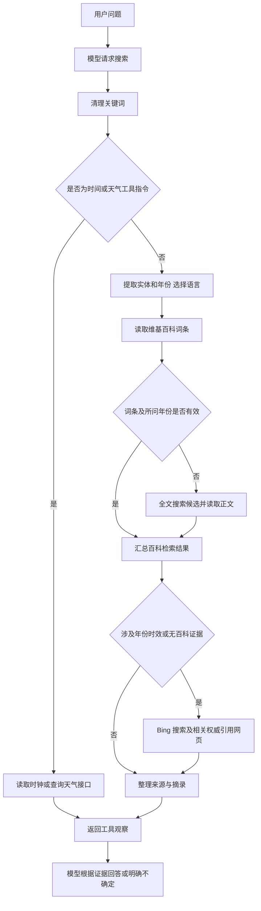

# 检索代码说明

本文说明当前项目怎样获取外部信息、怎样把证据交给模型，以及遇到失败时怎样记录和处理。适用于阅读代码、排查问答问题和撰写实现说明，不代替课程实验报告。

当前实现以**维基百科为第一信息源**，年度或时效性查询再补充 Bing 搜索及相关权威引用网页；当前时间与天气通过专门工具获取。程序返回的是证据或工具观察，最终答案仍由大模型生成，不能把“读到了页面”理解为“已经查证了答案”。

- 文档更新日期：2026-10-15。
- 检索版本：`wikipedia-web-runtime-v2`。
- 实现依据：项目现有源码及已保存的真实诊断记录。
- 当前验证范围：38 项离线测试、公开接口检索验证，以及 `exp_3` 的固定 30 题两模式实验。该轮盲答 18/30、RAG 19/30，提升 3.33 个百分点，尚未达到课程 5 个百分点要求；详见[本轮结果分析](../outputs/experiment/exp_3/结果分析.md)。

## 1 代码文件与职责

| 文件 | 主要职责 |
|---|---|
| [search_rag_example.py](../search_rag_example.py) | 模型调用、`搜索:` 指令解析、两轮工具调用上限，以及最终回答提取。 |
| [scripts/search_sources.py](../scripts/search_sources.py) | 信息源调度、实体与年份处理、维基百科查询、表格提取、Bing 搜索和辅助网页读取。 |
| [scripts/runtime_tools.py](../scripts/runtime_tools.py) | 系统时间、相对日期解析、城市定位和天气接口调用。 |
| [scripts/prompt_versions.py](../scripts/prompt_versions.py) | 三版提示词；V2/V3 说明来源规则、实时工具指令及不确定时的回答边界。 |
| [scripts/experiment_utils.py](../scripts/experiment_utils.py) | 搜索事件记录、并发日志隔离、课程评分及结果存档辅助函数。 |
| [tests/diagnose_search.py](../tests/diagnose_search.py) | 不加载 `.env`、不调用模型，单独验证实际检索过程并保存诊断 JSON。 |

`bing_search()` 的名称为兼容原教师代码而保留。它现在是一个委托入口，不再只执行 Bing 搜索：

```python
def bing_search(query, top_k=3):
    from scripts.search_sources import search
    return search(query, top_k=top_k)
```

`search()` 返回 `list[str]`。列表元素可以是百科摘录、辅助网页正文、搜索摘要、时间、天气数据或明确的工具失败说明。普通检索完全无证据时返回空列表。

## 2 整体调用流程

模型根据用户问题输出一行 `搜索: 关键词`。`rag_answer()` 识别这一行，执行 `bing_search()`，然后把工具结果加入上下文，再调用模型作答。



最多允许模型请求 **2 次搜索**。一次搜索指令内部可以访问多个页面，这些 HTTP 请求不是额外的模型搜索轮次。正常完成的问答因此可能有 1～3 次模型调用，每次输入 Token 都应累计统计。

这是一种使用文本标记实现的工具调用方式，没有使用模型服务商原生的函数调用接口。模型是否按规则请求工具，仍依赖提示词及模型行为。

## 3 关键词和维基百科检索

### 3.1 实体与年份分别处理

主要函数是 `_clean_query()`、`_entity_query()`、`_years()` 和 `_lookup_entity()`。

1. 清理多余空白，移除模型附带的 `site:` 条件，信息源由程序控制。
2. 有引号时，优先取引号中的完整实体名。
3. 识别 1900～2099 范围内的四位年份。
4. 从查找实体中移除年份及部分结尾属性词，例如“得主”“获奖者”“是谁”。原始查询仍保留，用于年份检查和摘录排序。

例如：

```text
原始查询：2026年诺贝尔物理学奖 得主
查找实体：诺贝尔物理学奖
证据约束：2026年
```

这样不要求网站一定存在名为“2026年诺贝尔物理学奖”的独立页面，也可以从相关名单中获取所问年份的记录。

这一处理属于规则匹配，不是通用自然语言理解。实体名称本身包含年份或被删除的属性词时，可能被错误简化；仍需通过真实问题检查。

### 3.2 按实体选择语言

查找实体含汉字时使用中文版，否则使用英文版。程序不自动翻译专有名词，也不自动切换到另一种语言继续查找。

```text
英文接口：https://en.wikipedia.org/w/api.php
中文接口：https://zh.wikipedia.org/w/api.php
```

`_wiki_request()` 负责 HTTP 请求、JSON 解析和访问结果记录。它检查状态码、返回域名、接口路径及关键查询参数；接口错误、无效 JSON、返回查询不一致等情况不会当作正常证据。

### 3.3 先查询实体词条

`_wiki_entry()` 使用官方 MediaWiki API 查询词条，关键参数包括：

| 参数 | 当前设置与用途 |
|---|---|
| `action=query` | 查询页面信息。 |
| `titles` | 要查找的实体或候选标题。 |
| `redirects=1`、`converttitles=1` | 处理重定向及标题转换。 |
| `prop=extracts\|info\|pageprops\|revisions` | 读取文本、来源 URL、页面属性和修订信息。 |
| `explaintext=1`、`exlimit=1` | 取得一个页面的纯文本。 |
| `rvprop=ids\|timestamp` | 记录修订编号和时间。 |

程序拒绝不存在的页面、非正文命名空间、消歧义页、无法解释的标题变化、错误来源域名和空内容。标题变化只能由接口返回的规范化、转换或重定向关系支持，不凭猜测认定两个实体相同。

### 3.4 词条无效时搜索候选

`_wiki_candidates()` 使用 `list=search`，只搜索正文命名空间 `0`，最多取得 6 个候选。程序清理搜索摘要中的 HTML，再进行词面相关性检查。

`_relevant()` 要求至少 60% 的有效关键词出现在标题或摘要中。英文词按词边界检查，避免把 `rice` 误匹配到 `price`；中文主要使用连续字符串匹配。

随后最多读取前 `top_k` 个通过筛选的候选，默认 `top_k=3`。这是轻量的规则筛选，没有使用向量数据库、嵌入模型或语义重排序模型。摘要不完整、别名和中文繁简差异仍可能造成漏检。

## 4 正文摘录与表格

### 4.1 为什么要读取表格

年度名单的答案经常保存在表格中。只读取 `extracts` 得到的文本，可能漏掉“年份—获奖者—类别”的对应关系。

当查询包含年份，或已有纯文本为空时，`_wiki_html()` 进一步使用 `action=parse` 读取页面 HTML。通常通过 `oldid` 指定已经记录的修订版本；中文页面请求简体展示。返回的 `pageid` 必须与前一步相符。

`_html_content()` 删除导航、脚本等内容，提取段落和表格。它保留表头，并展开 `rowspan` 中的跨行值，使同一年第二位得主不会丢失年份。数据会整理为这样的文本：

```text
年份：2026年 | 获奖者：…… | 国家：…… | 获奖原因：……
```

上述格式只是结构说明，不是完成证据。实际内容来自真实网页。

涉及所问年份的表格行还会解析引用链接。符合权威域名规则的实际引用 URL 可用于后续辅助网页读取，没有把某个问题的答案写入代码。

### 4.2 怎样选择摘录

`_wiki_excerpt()` 保留导语和最多两个排名靠前的段落，再按原文顺序拼接。包含所问年份的段落获得更高优先级，其他段落按属性关键词命中情况排序。

- 每个选中段落最多保留 600 字符。
- 每条摘录最多 1800 字符。
- 年度查询的摘录必须包含所问年份，否则记录 `insufficient_constraints`。

这个检查只确认年份出现，并不能证明年份、类别和答案一定对应正确。模型仍必须阅读表头、上下文和来源；人工核验也不能省略。长段落被截断时，目标信息仍可能遗漏。

不含年份且已有纯文本的查询，不一定会进一步读取 HTML 表格。

## 5 辅助网页检索

`_web_supplement()` 在以下情况执行：

- 查询含已识别的年份。
- 查询包含“最新、目前、当前、今天、本周”或 `latest/current/today/recent`。
- 没有取得百科摘录。

因此，年度或时效性问题不会因为“已经读到一个百科页面”就提前结束取证。

### 5.1 Bing 搜索

`_bing_candidates()` 请求 `https://www.bing.com/search`，解析前 6 条 `li.b_algo`，提取标题、链接和摘要。它检查返回查询，解码 Bing 包装的来源链接，去重并过滤明显无关项。

HTTP 200 和非空摘要不等于结果有效。本项目已经保存过 Bing 返回无关网页的真实诊断，这种结果会被排除。

### 5.2 优先读取相关权威引用

读取网页正文前，优先使用百科所问年份表格行中的实际引用链接，再考虑 Bing 候选中的权威 URL。默认最多尝试读取 2 个网页正文。

当前正文读取允许 HTTPS 下的以下域名及其子域名：

```text
nobelprize.org    who.int          medlineplus.gov
nhc.gov.cn       nmpa.gov.cn      chinacdc.cn
stats.gov.cn
```

普通 Bing 摘要并不受这份正文域名名单限制。域名名单只控制当前辅助正文读取范围，不能把域名符合条件直接等同于事实正确。

### 5.3 返回材料与来源标签

| 标签 | 表示什么 |
|---|---|
| `维基百科·中文/英文` | 已取得对应词条摘录。 |
| `辅助网页正文` | 已读取辅助网页，附实际来源 URL。 |
| `Bing 网页摘要` | 仅有搜索摘要，会注明未读取正文。 |
| `系统时钟` | 本机运行时获取的北京时间。 |
| `Open-Meteo天气数据` | 天气接口返回的数据与单位。 |
| `天气工具` | 参数缺失、定位失败或接口失败等工具说明，不能当成有效天气数据。 |

有辅助正文时优先返回正文；没有取得正文时，可以返回通过筛选的 Bing 摘要。普通检索默认最多返回 3 条材料，并在有百科证据时为辅助材料预留位置。

## 6 当前时间与天气

### 6.1 当前时间

`search_runtime()` 优先识别时间指令，由 `now_china()` 读取系统时钟，返回日期、时分秒及 `UTC+08:00`。

```text
搜索: 当前时间
```

该工具不访问网络，也不依赖模型训练日期。它依赖运行电脑的时钟准确，不能称为已经通过外部授时服务校准。V2/V3 引导模型遇到当前时间或其他问题中的相对日期时请求此工具，程序不会自动向每次模型调用注入时间。

### 6.2 天气指令与位置

天气使用明确的工具格式：

```text
搜索: 天气 城市=北京 日期=今天
搜索: 天气 城市=上海 日期=明天
搜索: 天气 城市=北京 日期=2026-10-15
```

这几行是指令格式示例，不是天气回答。用户正常输入“北京明天天气如何”，由模型依据提示词转换为指令。工具层不会自动识别所有自然语言天气表达。

缺少城市时，应先询问用户。城市定位通过 Open-Meteo Geocoding API 完成，最多取得 5 个候选。程序优先采用首都或一级行政中心；普通同名地点存在歧义时，要求补充省份或国家。返回数据包含实际解析的位置，不猜测用户所在地。

### 6.3 日期与天气数据

`_date_range()` 按北京时间解析今天、明天、后天、昨天、本周、未来一周及 ISO 日期。接口请求范围限制为当前日期之前 7 天至之后 15 天，超出范围明确说明无法提供。

```text
城市定位：https://geocoding-api.open-meteo.com/v1/search
天气查询：https://api.open-meteo.com/v1/forecast
```

返回字段包括每日天气代码、最高/最低温度和最大降水概率。所问区间包含今天时，还请求当前温度、湿度、体感温度、天气代码和风速。

所有日期按 `Asia/Shanghai` 解释，包括查询海外城市时；当前版本没有按城市自动切换当地时区。结果保留字段单位、查询时间和接口提供的数据时间，缺失值 `null` 不替换为零。

Open-Meteo 的当前状况是模型估计，未来日期是预报，过去日期是模型资料，均不冒充现场实测。定位、访问或日期匹配失败时，返回明确说明，不按季节或模型记忆猜测温度。

## 7 日志与版本记录

通过 `run_demo.py` 或 `evaluate.py` 调用时，`experiment_utils.install()` 包装检索函数。`capture_attempts()` 使用 `contextvars` 隔离并发问题的日志。

记录分两层：

- **模型工具请求**：关键词、开始/结束时间、返回材料、总体执行状态。
- **信息源尝试**：实际 API 参数、语言、状态码、最终域名与路径、接受/拒绝原因，以及词条修订信息等。不同信息源的字段不完全相同。

常见状态包括：

| 状态 | 含义 |
|---|---|
| `accepted` | 通过当前规则并取得材料；不代表已完成事实核验。 |
| `candidates` / `parsed` | 取得候选或解析了 HTML；不等同于最终返回证据。 |
| `not_entry` / `disambiguation` | 不是可用正文词条，或为消歧义页。 |
| `entity_mismatch` / `query_mismatch` | 返回实体或查询不一致。 |
| `insufficient_constraints` | 摘录未包含所问年份。 |
| `no_relevant_results` / `no_relevant_content` | 没有通过筛选的结果或正文。 |
| `challenge` / `http_error` / `ReadTimeout` | 验证页、HTTP 错误或读取超时。 |
| `missing_city` / `ambiguous_location` / `date_out_of_range` | 天气位置或日期条件不满足。 |

`selected_sources` 只记录实际进入返回材料的信息源，不能把发现候选、城市定位或失败尝试写成已经取得最终证据。总体状态 `ok` 仅表示函数正常结束，可能仍返回空列表或工具失败说明。

直接运行 `search_rag_example.py` 主要显示终端过程，不自动保存上述结构化会话日志。需要留存会话时，应使用 `run_demo.py`。

`configuration()` 记录检索策略及两个辅助模块的 SHA256。会话和实验保存配置；新实验另存 `search_sources.py`、`runtime_tools.py` 快照，配置不同拒绝续跑，避免混用新旧成绩。

## 8 诺贝尔奖查询的实际案例

问题：**2026年诺贝尔物理学奖得主是谁**。

旧版按完整年度名称查词条，没有找到独立页面；随后关键词筛选错过相关名单，并且纯文本摘录没有保留年度表格。取得一个泛泛的诺贝尔奖页面，也不足以回答所问物理学奖。

当前版本的真实过程是：

1. 查找“诺贝尔物理学奖”，把 2026 年保留为证据约束。
2. 该页面不能提供所问年份的证据，继续发现“诺贝尔物理学奖得主列表”。
3. 读取名单的 HTML 表格，保留 2026 年行中的获奖者和获奖原因。
4. 从该行实际引用中发现诺贝尔奖官网链接，读取官方正文。
5. 将名单表格与官网正文一起交给模型。

已保存的记录显示，名单列出**弗朗西斯·哈尔岑**，官网正文列出 **Francis Halzen**。出处：[诺贝尔奖官网](https://www.nobelprize.org/prizes/physics/2026/summary/)。这个名字来自网页内容，不存在于检索代码的答案映射中。

本次记录中，Bing 没有取得相关结果，成功的辅助正文来自百科中的实际官方引用。因此不能把这次成功全部归因于 Bing，也不能据此宣称任意问题都能检索成功。

真实验证记录为 `outputs/diagnostics/search_20261014_224901_482425.json`；修改前后源码快照与验证清单保存在 `outputs/retrieval_versions/wikipedia_web_20261014_223112/`。这些记录验证工具取证，不代替模型最终回答、手工截图或课程准确率实验。

## 9 运行和排查

在项目根目录执行，复用已有 `.venv`，不需要为检索模块新增依赖。模型问答仍需要原有模型配置；独立检索诊断不需要读取模型密钥。

**启动问答或保存 V3 会话：**

```powershell
.\.venv\Scripts\python.exe -X utf8 search_rag_example.py
.\scripts\run_project.ps1 -Task demo -Version V3
```

以上两个入口择一使用。修改代码或提示词后，先输入 `quit` 退出，再重新启动；已运行的 Python 进程不会自动加载修改。

**只检查检索与实时工具，不调用模型：**

```powershell
.\.venv\Scripts\python.exe -X utf8 tests\diagnose_search.py --query '2026年诺贝尔物理学奖 得主'
.\.venv\Scripts\python.exe -X utf8 tests\diagnose_search.py --query '当前时间'
.\.venv\Scripts\python.exe -X utf8 tests\diagnose_search.py --query '天气 城市=北京 日期=明天'
```

**运行离线测试：**

```powershell
.\.venv\Scripts\python.exe -X utf8 -m unittest discover -s tests -p 'test_*.py'
```

检索后仍答不对时，依次检查实际关键词、候选标题、是否含所问年份/类别、摘录是否保留答案、来源是否有效，再判断模型是否误读。不要仅凭“摘录数量大于零”判定检索成功。

若要评价准确率，应按[实验指南](实验指南.md)重新运行固定 30 题的两模式 60 项任务，另存新实验目录，保留失败题，不挑选答案。输入 Token 按每题全部模型调用累计；不能只比较最后一次调用。

## 10 当前限制与参考资料

当前实现适合课程项目的轻量检索，仍有以下明确限制：

- 规则匹配不能完整理解实体、年份和关系，误删实体信息及误收同名内容仍有可能。
- 年份出现检查不等于关系核验；摘要截断、表格嵌套和复杂合并单元格仍可能造成遗漏。
- 辅助正文域名只覆盖当前名单中的来源；其他网站可能仅返回搜索摘要。
- 网络、验证页和限流会导致接口失败；当前代码没有通用自动重试或离线知识回退。
- 当前时间依赖本机时钟，天气采用北京时间及有限日期范围，没有历史观测库或任意城市时区自动切换。
- 模型可能不按工具指令作答。38 项测试及真实接口验证不证明最终回答必然正确，也不证明 RAG 准确率高于盲答。

官方接口资料：

- [MediaWiki 搜索 API](https://www.mediawiki.org/wiki/API:Search)
- [MediaWiki 文本提取接口](https://www.mediawiki.org/wiki/Extension:TextExtracts#API)
- [MediaWiki 页面解析接口](https://www.mediawiki.org/wiki/API:Parsing_wikitext)
- [Open-Meteo 天气接口](https://open-meteo.com/en/docs)
- [Open-Meteo 城市定位接口](https://open-meteo.com/en/docs/geocoding-api)

版本核对用源码 SHA256：

```text
scripts/search_sources.py
f3c2009b8219b4e1128e68e9496611be637cda9d3730dcc229b93bdc1f859c41

scripts/runtime_tools.py
d6ee225239a61796ab0fa139747ef1c028891f90d4432b728d14e1bda3b6450c
```

源码变化后，这些哈希和本文描述应一并核对更新。
