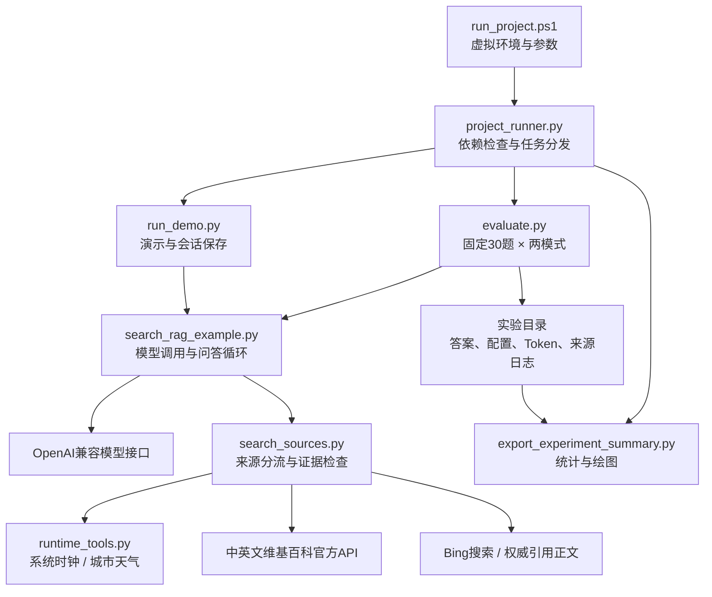

# RAG 项目索引

用于快速了解整体架构、查找模块和定位输出。当前方案是**维基百科正文优先，Bing与权威引用网页补充，时间和天气由专用工具提供**；默认角色为健康科普与医疗信息查询助手。

阅读顺序：[启动说明](README.md) → 本索引 → [实验指南](docs/实验指南.md) → [检索代码说明](docs/检索代码说明.md)。

## 1. 按需求查询

| 我想做什么 | 去哪里看 |
|---|---|
| 安装依赖、运行程序 | [README](README.md)、[统一启动器](scripts/run_project.ps1) |
| 理解模型如何搜索和回答 | [核心问答](search_rag_example.py) 的 `rag_answer()` |
| 查看或修改V1/V2/V3 | [提示词](scripts/prompt_versions.py)、[维护规则](docs/实验指南.md#提示词维护) |
| 查看百科、Bing、网页正文处理 | [检索模块](scripts/search_sources.py)、[详细说明](docs/检索代码说明.md) |
| 查询当前时间和城市天气 | [实时工具](scripts/runtime_tools.py) |
| 保存三版真实问答 | [演示入口](scripts/run_demo.py)、[实验指南](docs/实验指南.md) |
| 运行固定30题实验 | [评测入口](scripts/evaluate.py) |
| 查询判分和Token累计 | [实验公共模块](scripts/experiment_utils.py)、[评价规则](docs/实验指南.md#评价规则) |
| 导出准确率图、五题Token表 | [导出模块](scripts/export_experiment_summary.py) |
| 排查检索结果无关或失败 | [检索诊断](tests/diagnose_search.py)、[日志位置](#5-输出与日志) |
| 查看课程要求和修改边界 | [项目目标](RAG项目目标.md)、[协作约定](AGENTS.md) |
| 回顾历史问题和旧代码 | [开发记录](docs/历史说明/开发记录.md)、[旧代码快照](docs/历史说明/search_rag_old.py) |

## 2. 整体架构

- **问答**：问题 → 模型直接回答，或输出 `搜索: 关键词` → 工具返回材料 → 模型输出 `回答: 内容`。每题最多两轮工具调用，一轮内部可尝试多个来源。
- **检索**：时间／天气指令先分流；普通查询先读百科词条，无有效词条则发现候选。无百科证据或涉及年份／时效词时补充网页材料。
- **实验**：固定样本 → 两模式60项 → 保存完整结果 → 课程字符串评分 → 图表。标准答案仅参与评分。
- **公共能力**：`experiment_utils.py`提供评分、目录和来源日志；`prompt_versions.py`提供三版提示词。

`bing_search()`保留原函数名，现在委托`search_sources.search()`执行，已经包含百科、网页和实时工具。

## 3. 运行模块

| 模块 | 职责与主要函数 | 输入 → 输出 |
|---|---|---|
| [run_project.ps1](scripts/run_project.ps1) | 创建／复用`.venv`、UTF-8、参数转发 | Task等参数 → Python任务及退出码 |
| [project_runner.py](scripts/project_runner.py) | `prepare_dependencies()`、`dispatch()`、`print_summary()`；依赖安装、`pip check`、任务分发 | 任务参数 → 演示／测试／评测／导出 |
| [search_rag_example.py](search_rag_example.py) | `call_llm()`、`bing_search()`、`rag_answer()`、`blind_answer()`、`main()` | 问题 → 答案与搜索日志 |
| [prompt_versions.py](scripts/prompt_versions.py) | `V1`、`V2`、`V3`、`PROMPTS`；角色、规则、Few-shot与工具指令 | 版本名 → 提示词 |
| [run_demo.py](scripts/run_demo.py) | `start_session()`、`answer_and_save()`、`save_session()`；每题独立、逐题保存 | 自选问题与版本 → 会话JSON |
| [evaluate.py](scripts/evaluate.py) | `versions()`、`run_one()`、`tracked_create()`、`main()`；抽样、并发、续跑、usage | 数据集和配置 → 独立实验目录 |
| [experiment_utils.py](scripts/experiment_utils.py) | `correct()`、`record_correct()`、`write_results()`；目录编号；`install()`、`capture()` | 回答／事件 → 评分、CSV、日志、目录 |
| [export_experiment_summary.py](scripts/export_experiment_summary.py) | 参数解析后直接执行；完整性检查、统计、Pillow绘图 | 实验目录 → 图表、Token表、摘要 |

### 检索模块内部

| 文件／函数组 | 负责内容 |
|---|---|
| [search_sources.py](scripts/search_sources.py)：`search()` | 总入口、来源优先级和返回材料数量 |
| `configuration()`、`capture_attempts()`、`_record()` | 策略、源码哈希和逐来源尝试 |
| `_clean_query()`、`_lookup_entity()`、`_relevant()` | 查询清理、实体与年份拆分、词面相关性 |
| `_wiki_request()`、`_wiki_entry()`、`_wiki_candidates()` | API请求、直接词条、候选发现与正文 |
| `_wiki_html()`、`_html_content()`、`_wiki_excerpt()` | 年份表格、跨行值、引用链接与摘录 |
| `_bing_candidates()`、`_web_supplement()` | 查询一致性、Bing候选、权威正文与摘要回退 |
| [runtime_tools.py](scripts/runtime_tools.py)：`now_china()` | 本机系统时钟，北京时间UTC+08:00 |
| `search_runtime()`、`_date_range()`、`_json_get()` | 时间／天气指令、日期解析、城市定位及天气接口 |

工具指令例如`搜索: 当前时间`、`搜索: 天气 城市=北京 日期=明天`。天气是模型资料或预报，不是现场实测；详细范围与限制见[检索说明](docs/检索代码说明.md)。

## 4. 测试和辅助文件

| 文件 | 内容 |
|---|---|
| [test_project_runner.py](tests/test_project_runner.py) | 缺失依赖、失败停止、任务分发、指定目录导出 |
| [test_search_sources.py](tests/test_search_sources.py) | 词条、来源、表格、权威引用、回退与并发日志 |
| [test_runtime_tools.py](tests/test_runtime_tools.py) | 时钟、天气日期、地点歧义、接口失败及未知字段 |
| [test_evaluation_standard.py](tests/test_evaluation_standard.py) | 字符串评分、失败计错、固定分母与六列CSV |
| [test_experiment_paths.py](tests/test_experiment_paths.py) | 编号、已有结果保护、并发创建 |
| [diagnose_search.py](tests/diagnose_search.py) | 公开接口诊断，保存材料与尝试；不调用模型 |
| [render_word_pages.ps1](tools/render_word_pages.ps1) | 已有Word分页渲染，需本机Word；不是报告生成器 |
| [requirements.txt](requirements.txt) | openai、requests、beautifulsoup4、python-dotenv、Pillow |
| [.env.example](.env.example) | 首次配置模板；实际凭据保存在本地`.env`或环境变量 |
| [第三部分对比表模板.csv](docs/第三部分对比表模板.csv) | 用户填写真实人工评价，不预填成绩 |

离线测试：`.\scripts\run_project.ps1 -Task test`。独立诊断：`.\.venv\Scripts\python.exe -X utf8 tests\diagnose_search.py --query '当前时间'`。

## 5. 输出与日志

| 位置 | 查询用途 |
|---|---|
| [data/](data/) | 官方NQ-open开发集缓存 |
| [outputs/sessions/](outputs/sessions/) | 演示问题、实际提示词、回答、来源与配置 |
| [outputs/experiment/](outputs/experiment/) | 第四部分按`exp_序号`独立保存 |
| [outputs/diagnostics/](outputs/diagnostics/) | 接口诊断材料，不代替实验成绩或截图 |
| [outputs/retrieval_versions/](outputs/retrieval_versions/) | 百度百科、维基百科及辅助工具的历史实现快照 |
| [outputs/screenshots/](outputs/screenshots/) | 用户手工保存的真实截图 |
| [reports/](reports/) | 可编辑Word报告 |

每轮实验主要文件：`sample30.json`为固定题目；`metadata.json`和`prompts.json`为实际配置；`raw_results.json`及`search_traces/`为回答、状态、逐次usage和来源；`results.csv`为六列评分；`task_details.csv`为任务状态和累计Token；`summary.json`、`accuracy.png`、`token_comparison.csv`及`实验结果摘要.md`为统计。检索实现快照另存`search_sources.py`、`runtime_tools.py`。

排查顺序：**问题与关键词 → `source_attempts`状态 → 实际注入材料 → 模型回答 → 评分**。`selected_sources`表示最终材料的来源；HTTP成功、候选命中或非空摘要都不能证明答案正确。

## 6. 文档分工与边界

- [README](README.md)：配置和启动；[实验指南](docs/实验指南.md)：实验、评分、Token与报告。
- [检索代码说明](docs/检索代码说明.md)：实现细节；[开发记录](docs/历史说明/开发记录.md)：历史问题与演进。
- [项目目标](RAG项目目标.md)：教师要求；[AGENTS.md](AGENTS.md)：当前授权和协作约束。

V2/V3需同步核心文件和提示词副本；修改范围先核对AGENTS.md。实验另存版本，固定集调优须说明；截图、人工核验、真实分工和总结由用户提供。`.env`、`.venv`、输出及数据缓存不提交Git。

归档的[旧版代码](docs/历史说明/search_rag_old.py)仅用于阅读对照，当前运行入口见README。
